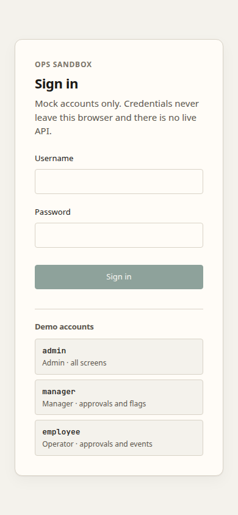
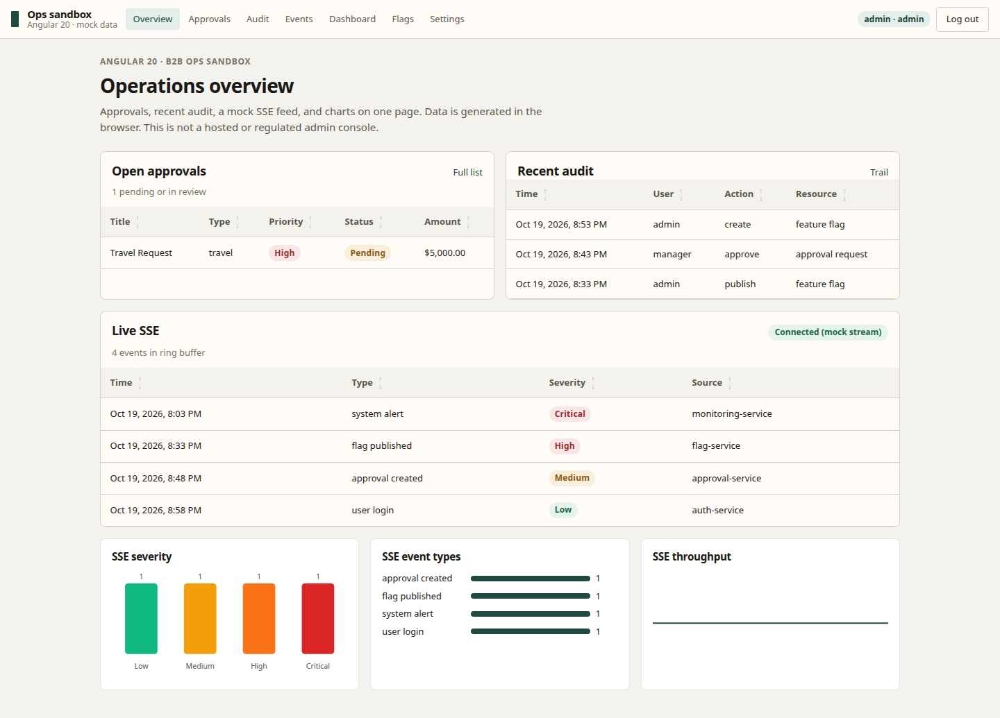

# Angular Dashboard Sandbox

[](https://github.com/tessOu56/angular-dashboard-sandbox/actions/workflows/ci.yml)
[](https://angular.dev)
[](https://www.typescriptlang.org/)
[](https://pnpm.io/)
[](./LICENSE)

Angular 22 **labelled sandbox** for B2B ops UI patterns: Signals, route/UI RBAC, dual-control approvals, SSE event feed, audit log. **No hosted demo.** Data is a **mock backend**. This is not a regulated or production admin console.

## What this proves

| Proof | Honest bound |
|-------|----------------|
| **Angular 22 + Signals** | Standalone components, Signal Store, typed forms — run locally (`pnpm start` → http://localhost:4200). |
| **Ops UI patterns** | Login → approvals / audit → SSE. Dual-control is an in-app rule (budget/purchase ≥ $10k), **not** a compliance certification. |
| **Not claimed** | No public URL. No live API. Backend integration is unfinished. Accessibility helpers exist; **not** a WCAG audit. |

**Relationship:** extract of `apps/enterprise-admin` in [`nx-playground`](https://github.com/tessOu56/nx-playground). Recruiter view: Angular B2B slice, not the event CMS.

## What you will see

Local only: `pnpm start` → http://localhost:4200. Unauthenticated visits go to `/login`. After `admin` / `admin` the app lands on `/slice` (approvals, audit, mock SSE, charts). Other list routes share the same chrome. Form and detail routes are labelled stubs, not dead ends.

| Screen | Desktop | Mobile |
|--------|---------|--------|
| Sign in |  |  |
| Overview (`/slice`) |  |  |

**GitHub About:** `Angular 22 B2B ops sandbox — Signals, RBAC, dual-control, SSE. Local mock API only; not hosted, not a regulated system.`  
**Topics:** `angular` · `typescript` · `rbac` · `signals` · `labelled-demo`

## 🎯 專案簡介

模擬企業內部後台的練習切片（**非生產、非金融監管認證**），用來展示 Angular 架構與常見 ops UI 模式。

> **與 nx-playground 的關係**：本 repo 是 Angular 企業後台的 **canonical 完整度對象**（T-2026-224）。`nx-playground` `apps/enterprise-admin` 不是這條切片的 SSOT，也不是活動 CMS（`event-cms`）的替代品。產能刻意遠小於 React 活動棧。本 repo 沒有獨立托管 demo；評估以 `/slice` 為準。

### 核心特色

- **🔐 RBAC 權限控制** - 路由守衛、UI 層級權限控制（練習用帳密，見下方）
- **✅ Dual-control 審批流程** - 高風險操作雙重審批（應用內規則，不是監管認證）
- **📝 動態表單系統** - Schema-driven 表單生成、交叉驗證、自動保存草稿
- **⚡ 即時事件監控** - SSE 串流 + Ring Buffer（mock 資料）
- **📊 稽核軌跡** - 記錄操作、查詢與匯出（mock）
- **🚀 效能優化** - 虛擬卷動、懶加載路由
- **🎨 UI** - 現代化界面；無障礙是目標，未經正式 WCAG 稽核
- **🔄 Signal Store** - Angular Signals 狀態管理

## 📋 環境要求

- **Node.js**: 22.22.3+、24.15+ 或 26（Angular 22 最低 Node 22.22.3；`package.json` `engines` 與官方相容表一致）
- **pnpm**: 9.0.0+
- **瀏覽器**: 支援 ES2022 的現代瀏覽器

## 🚀 快速開始

### 安裝依賴

```bash
# 使用 pnpm
pnpm install
```

### 開發伺服器

```bash
# 設定 Node.js 路徑（macOS with Homebrew）
export PATH="/opt/homebrew/opt/node@20/bin:$PATH"

# 啟動開發伺服器
pnpm start

# 完整度切片：http://localhost:4200/slice
# 未登入會先到 /login，成功後落到同一頁（審批／稽核 + SSE + 圖表）
```

### 建置專案

```bash
# 生產環境建置
pnpm build

# 建置檔案將輸出到 dist/ 目錄
```

## 🧪 測試

### 單元測試

```bash
# 執行所有測試
pnpm test

# CI / headless（ChromeHeadlessCI）
pnpm test:ci

# Watch 模式
pnpm test:watch

# 產生覆蓋率報告
pnpm test:coverage
```

Push and pull requests run `pnpm install` → `pnpm test:ci` → `pnpm build`. `pnpm lint` is not wired (`ng lint` has no architect target). Playwright `e2e` stays local: several specs still target stub form/detail routes.

### E2E 測試

```bash
# 執行所有 E2E 測試
pnpm e2e

# UI 模式（互動式）
pnpm e2e:ui

# Debug 模式
pnpm e2e:debug
```

## 📚 專案文檔

- **[ARCHITECTURE.md](./ARCHITECTURE.md)** - 架構設計與核心功能說明
- **[IMPLEMENTATION.md](./IMPLEMENTATION.md)** - 實現細節與開發指南

## 🏗️ 專案架構

```
src/
├── shared/sdk/          # @alloylab/types & @alloylab/sdk
├── app/
│   ├── core/           # 核心服務（auth, http, logger, events, mock）
│   ├── shared/         # 共用元件（UI, pipes, validators, directives, forms）
│   ├── store/          # Signal Store 狀態管理
│   ├── features/       # 功能模組
│   │   ├── dashboard/  # 儀表板
│   │   ├── approvals/  # 審批中心（含 Dual-control）
│   │   ├── flags/      # 旗標管理
│   │   ├── events/     # 事件監控（SSE）
│   │   ├── settings/   # 平台設定
│   │   └── audit/      # 稽核瀏覽
│   └── testing/        # 測試工具
└── environments/       # 環境配置
```

## 🔑 登入帳號（開發用）

| 使用者名稱 | 密碼     | 角色     | 權限           |
| ---------- | -------- | -------- | -------------- |
| admin      | admin    | Admin    | 所有權限（\*） |
| manager    | manager  | Manager  | 管理與審批     |
| employee   | employee | Operator | 基本操作       |

These accounts exist only in the in-browser mock backend. Route guards and `*hasPerm` are **client-side UI demos**, not a server authorization boundary. Tokens are mock strings in `localStorage`.

## 🌟 核心功能

### 1. RBAC 權限控制

```typescript
// 路由守衛
{
  path: 'approvals',
  canMatch: [RequirePermGuard],
  data: { requirePerm: [Permission.VIEW_APPROVALS] }
}

// UI 控制
<button *hasPerm="[Permission.CREATE_APPROVAL]">新增審批</button>
<div *hasRole="[UserRole.ADMIN, UserRole.MANAGER]">管理功能</div>
```

### 2. Dual-control 審批

```typescript
// 自動判斷高風險操作
const isDualControl = dualControlService.requiresDualControl(request);

// 檢查審批權限
const { canApprove, reason } = dualControlService.canApprove(request);

// 追蹤進度
const progress = dualControlService.getApprovalProgress(request);
// { current: 1, required: 2, percentage: 50 }
```

**觸發條件**:

- 類型為 `budget` 或 `purchase`
- 金額 ≥ $10,000

### 3. 即時事件監控

```typescript
// 啟動 SSE 串流
eventsSse.start('http://localhost:3000/api/events/stream');

// 取得即時事件
const events = eventsSse.recentEvents();
const critical = eventsSse.criticalEvents();

// 停止串流
eventsSse.stop();
```

### 4. Signal Store 狀態管理

```typescript
// 注入 store
store = inject(ApprovalsStore);

// 載入資料
await store.fetchApprovals();

// 使用計算屬性
const pending = store.pendingApprovals();
const highPriority = store.highPriorityApprovals();

// 篩選
store.setFilters({ status: ['pending'], priority: ['high'] });
```

### 5. Typed Forms

```typescript
// 建立表單
const form = typedFormService.createForm(fields, initialValues);

// 套用條件邏輯
typedFormService.applyConditionalLogic(form, 'amount', conditional);

// 自動保存草稿
const cleanup = draftService.autoSave('form-id', form, 30000);
```

## 🎨 UI 元件庫

### 基礎元件

- **Button** - 多樣式按鈕（primary, secondary, success, danger, outline）
- **Table** - 基礎表格（排序、篩選）
- **Spinner** - 載入動畫
- **Toast** - 通知系統
- **Modal** - 對話框

### 進階元件

- **DataGrid** - 進階資料表格（虛擬卷動、多選）
- **VirtualScroll** - 虛擬卷動容器（優化大列表）

### 指令

- **\*hasPerm** - 權限控制
- **\*hasRole** - 角色控制
- **appDebounce** - 防抖動
- **appLazyImage** - 延遲載入圖片

### Pipes

- **dateFormat** - 日期格式化
- **statusBadge** - 狀態徽章

## 📈 效能優化

### 虛擬卷動

```typescript
<app-data-grid
  [data]="largeDataset"
  [height]="600"
  [rowHeight]="50"
  [bufferSize]="5"
></app-data-grid>
```

### 延遲載入

```html

```

### 防抖動

```html
<input appDebounce [debounceTime]="500" (debounced)="onSearch($event)" />
```

## ♿ 無障礙（目標，未經正式稽核）

- 鍵盤導航（Tab, Enter, Escape）
- ARIA 屬性與 Skip Link
- 高對比度 / `prefers-reduced-motion` 偏好
- **Not claimed:** WCAG 2.1 AA certification

## 🧪 測試

### 單元測試範例

- `permission.service.spec.ts` - 權限服務測試
- `approvals.store.spec.ts` - 狀態管理測試

### E2E 測試範例

- `e2e/approvals.spec.ts` - 審批流程完整測試

### 測試工具

- `src/app/testing/test-helpers.ts` - 測試輔助函數

## 📖 API 文檔

In-process **mock SDK only**. There is no hosted or public API. `sdk.*` calls never leave this sandbox.

### SDK 使用方式（mock）

```typescript
import { firstValueFrom } from 'rxjs';
import { sdk } from '../shared/sdk';

// 審批 API
const approvals = await firstValueFrom(sdk.approvals.list());
const approval = await firstValueFrom(sdk.approvals.get(id));
await firstValueFrom(sdk.approvals.approve(id, comment));

// 旗標 API
const flags = await firstValueFrom(sdk.flags.list());
await firstValueFrom(sdk.flags.publish(id));

// 事件 API
const events = await firstValueFrom(sdk.events.list());

// 稽核 API
const auditLogs = await firstValueFrom(sdk.audit.list(filters));
const csv = await firstValueFrom(sdk.audit.export());
```

## 🔧 開發工具

### 程式碼格式化

```bash
# 使用 Prettier
pnpm exec prettier --write "src/**/*.{ts,html,css}"
```

### Linting

```bash
pnpm lint
```

### 建置分析

```bash
# 分析 bundle 大小
pnpm build --stats-json
pnpm exec webpack-bundle-analyzer dist/angular-dashboard-sandbox/stats.json
```

## 📝 開發規範

### 元件

- 使用 Standalone Components
- 依賴注入使用 `inject()`
- 狀態使用 Signals
- 遵循 Single Responsibility Principle

### 服務

- 使用 `@Injectable({ providedIn: 'root' })`
- 避免服務間循環依賴
- 適當使用 RxJS operators

### 測試

- 單元測試覆蓋率 ≥ 80%
- 所有公開 API 需要測試
- 使用 Mock 資料

<a id="route-status"></a>

## 🗺️ 路由結構

`/` and unknown paths redirect to `/slice`. **`/slice` is the honesty checkpoint**: login → approvals / audit → mock SSE + charts. Other routes are extra surface, not a live integration.

| Route | What | Status | Data |
| ----- | ---- | ------ | ---- |
| `/login` | Demo login | mock-complete | Local users (`admin` / `manager` / `employee`) |
| `/slice` | Completeness slice | mock-complete | Mock stores + mock SSE (`eventsSse.start('mock')`) |
| `/dashboard` | Stats + lists | mock-complete | Same mock stores; localhost SSE URL still uses the mock stream |
| `/approvals` | Approval list | mock-complete | Mock SDK / store |
| `/approvals/new` | Create form | stub | Placeholder (“under development”) |
| `/approvals/:id` | Approval detail | stub | Placeholder |
| `/flags` | Flag list | mock-complete | Mock store |
| `/flags/new` | Create form | stub | Placeholder |
| `/flags/:id` | Flag detail | stub | Placeholder |
| `/flags/:id/compare` | Compare | stub | Placeholder |
| `/events` | Event monitor | mock-complete | Mock SSE on localhost |
| `/events/:id` | Event detail | stub | Placeholder |
| `/settings` | Settings home | stub | Placeholder |
| `/settings/dictionary` | Dictionary | stub | Placeholder |
| `/settings/webhooks` | Webhooks | stub | Placeholder |
| `/settings/permissions` | Permissions | stub | Placeholder |
| `/audit` | Audit list | mock-complete | Mock SDK |
| `/audit/:id` | Audit detail | stub | Placeholder |
| `/unauthorized` | RBAC deny page | mock-complete | Static page |

**Status key:** `mock-complete` = usable UI on local mock data. `stub` = routed placeholder, not a working feature. No public live API.

## 📊 專案狀態

### 已完成 ✅

- [x] T-2026-224 完整度切片：登入 → 審批／稽核 → SSE／圖表同一頁
- [x] 專案架構重構
- [x] 共用型別與 SDK
- [x] RBAC 權限系統
- [x] Typed Forms 與草稿系統
- [x] Dual-control 審批
- [x] Signal Store 狀態管理
- [x] 即時事件監控（SSE）
- [x] 稽核軌跡系統
- [x] Mock Backend 服務
- [x] 單元測試框架
- [x] E2E 測試框架
- [x] 效能優化（虛擬卷動、懶加載）
- [x] UI/UX 增強（動畫、Toast、Modal）
- [x] 無障礙輔助（未經 WCAG 稽核）

### 待開發 ⏳

- [ ] 完整的功能頁面（Form, Detail 等）
- [ ] 後端 API 整合
- [ ] 更多測試案例
- [ ] 效能監控整合
- [ ] 部署設定

## 📚 詳細文檔

- **[ARCHITECTURE.md](./ARCHITECTURE.md)** - 完整架構設計文檔
- **[IMPLEMENTATION.md](./IMPLEMENTATION.md)** - 實現細節與開發指南

## 🤝 貢獻

歡迎貢獻！請確保：

1. 所有測試通過
2. 程式碼覆蓋率 ≥ 80%
3. 遵循 Angular 風格指南
4. 更新相關文檔

## 📄 授權

[MIT License](./LICENSE)

## 🔗 相關資源

- [Angular Documentation](https://angular.dev)
- [TypeScript Documentation](https://www.typescriptlang.org/)
- [RxJS Documentation](https://rxjs.dev/)
- [Playwright Documentation](https://playwright.dev/)
- [WCAG 2.1 Guidelines](https://www.w3.org/WAI/WCAG21/quickref/)
